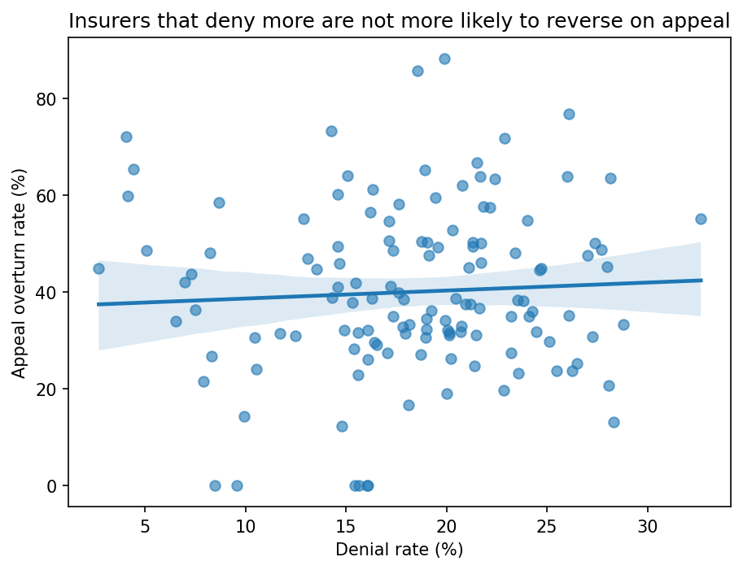

# ACA Marketplace Claim Denials and Appeals

**Author:** Wanjiru Randolph · M.S. Applied Statistics & Data Science, University of Texas at Arlington  
**Tools:** Python (pandas, statsmodels, scipy, seaborn)

**Does a high denial rate reflect strict coverage policy, or inaccurate claim review?**

A denial rate alone can't distinguish the two. An insurer applying narrow but
correctly-administered coverage rules and an insurer making frequent review errors
can both post high denial rates.

The appeal overturn rate separates them. When an insurer reverses a large share of
the denials members appeal, its initial determinations weren't holding up under
review — a signal of process error rather than policy stringency.

## What I found

**They don't move together.** Across 131 insurers, denial rate and appeal overturn
rate are essentially uncorrelated (Pearson r = 0.06; Spearman ρ = 0.06, p = 0.51).



A multiple linear regression tells the same story. Denial rate is not significant
(p = 0.44) holding appeal rate and insurer size constant, and the model explains
about 4% of the variation in overturn rates (R² = 0.042, F-test p = 0.14). Only
appeal rate reaches significance (coefficient −1.78, p = 0.04) — insurers where a
larger share of denials get appealed tend to overturn a smaller share — though that
sits inside a model that isn't jointly significant, so it's suggestive at best.

Residuals are patternless and centred on zero, and a Q-Q plot shows they are roughly
normal, so this isn't a misspecified model.
The predictors simply don't carry signal.


**Takeaway:** a high denial rate does not by itself indicate an inaccurate review
process. Overturn rates range from 0% to nearly 90% across these insurers, but no
insurer-level characteristic in this file accounts for that spread.

## Why it matters

A denial that gets reversed on appeal is rework. The insurer reviewed the claim,
denied it, processed the appeal, reviewed it again, and paid anyway — arriving
where it would have without the first denial. Identifying where that concentrates
points at which parts of a review process are misfiring. This analysis suggests the
denial rate isn't a useful screen for finding it.

For hospitals, this means an insurer's denial rate doesn't show whether its denials
are correct. Some insurers reverse most of the denials that get appealed, so for those
insurers, appealing is often worth the effort.

## Data

CMS Transparency in Coverage Public Use File (PY2026 release), which reports
claims and appeals data from plan year 2024. Individual medical QHPs.
https://www.cms.gov/marketplace/resources/data/public-use-files

**Scope limits:**

- HealthCare.gov states only — no state-based marketplaces (California, New York),
  and no employer group plans, which cover most insured people under 65.
- In-network claims only.
- Denials here include billing errors, duplicate submissions, and eligibility
  issues alongside medical necessity denials, so a raw denial rate is not a measure
  of plan quality. CMS says so in its file disclaimer.

## Approach

1. Loaded the individual medical sheet (headers begin on row 3, below a title and
   a legend).
2. **Collapsed to issuer level.** Rows are plans, but the `Issuer_` columns repeat
   identical totals across every plan an issuer sells. Verified nothing varies
   within an issuer, then deduplicated: 4,159 plan rows → 185 issuers. Left at plan
   level, each insurer would be weighted by how many products it happens to sell,
   and 4,159 rows would be treated as independent when there are at most 185.
3. Converted measure columns to numeric, counting each missing marker first.
4. Filtered to issuers above 1,000 in-network claims → 131 with both rates usable.
5. Built denial rate, appeal rate, and log claim volume.
6. Pearson correlation with Spearman as a robustness check, then multiple linear
   regression (OLS) of overturn rate on denial rate, appeal rate, and log claim
   volume, with residual diagnostics (residuals vs. fitted and a Q-Q plot).

## Data quality notes

**Four kinds of missing.** The file uses `*` (not available), `**` (suppressed for
small counts), `***` (not required for this plan type), and `N/A` (issuer new to the
exchange). These aren't interchangeable, and they're why most count columns load as
text rather than numbers.

`**` is not random — CMS suppresses small counts, so the insurers that drop out are
systematically the small ones. Findings here describe larger insurers.

**An encoding artifact.** Two plan-level columns showed 97 more non-null values than
their neighbours. Those rows contain `***` rather than counts: some issuers typed
the placeholder where others left the cell empty. Non-null does not mean present.

## Caveats

- 131 observations. Nothing elaborate would be supported.
- Insurer-level associations only — no causal claims.
- Appeals are rare, so overturn rates for smaller insurers are noisy.
- The outcome is a bounded percentage and OLS doesn't know that. The Q-Q plot shows
  a small departure in the lower tail, which doesn't change the conclusions but is
  a simplification worth naming.
- All claims and appeals data is self-reported by issuers to CMS, not independently
  audited. Differences between insurers may partly reflect differences in how they
  count and classify denials rather than differences in behaviour.

## Next steps

- Binomial regression weighted by number of appeals, built for "overturned out of
  appealed" outcomes.
- Sensitivity check on the claim-volume cutoff (500 and 5,000 instead of 1,000).
- Add state-based marketplaces and employer plans if comparable data becomes available.

## Running it

```
pip install pandas openpyxl matplotlib seaborn statsmodels scipy
jupyter notebook analysis.ipynb
```
 
The Excel file needs to sit alongside the notebook — download it from the CMS link above.
 
## Files
 
- `analysis.ipynb` — the full analysis
- `figures/` — output charts